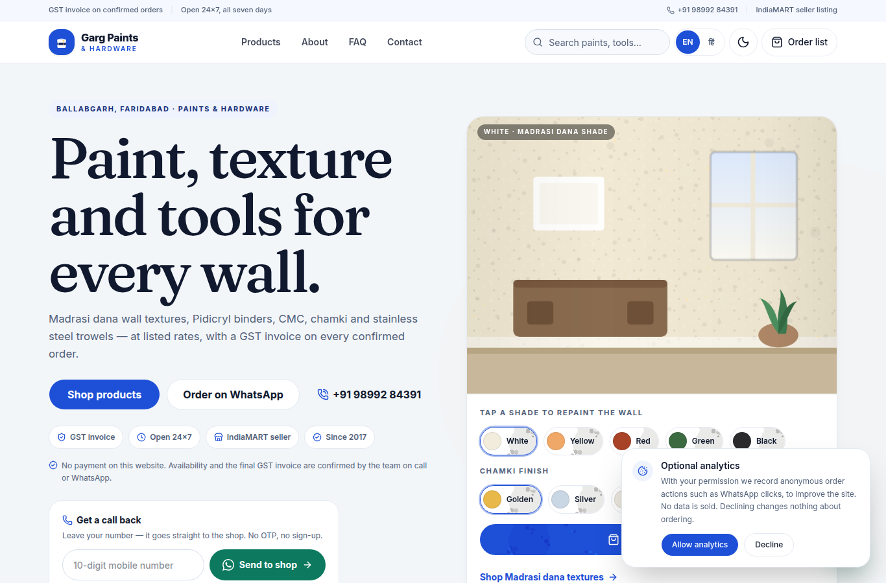
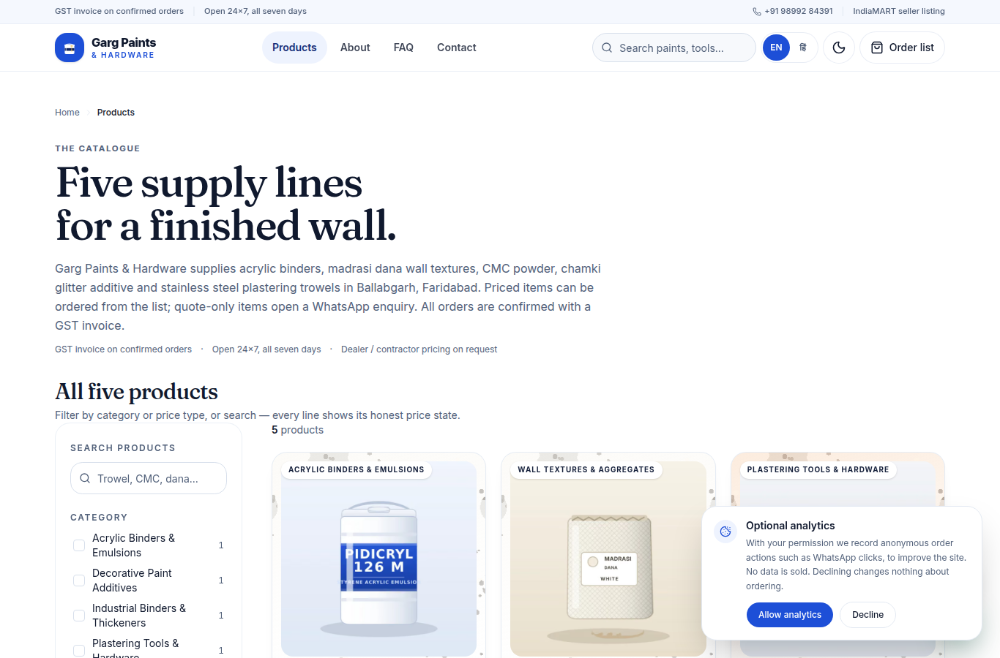
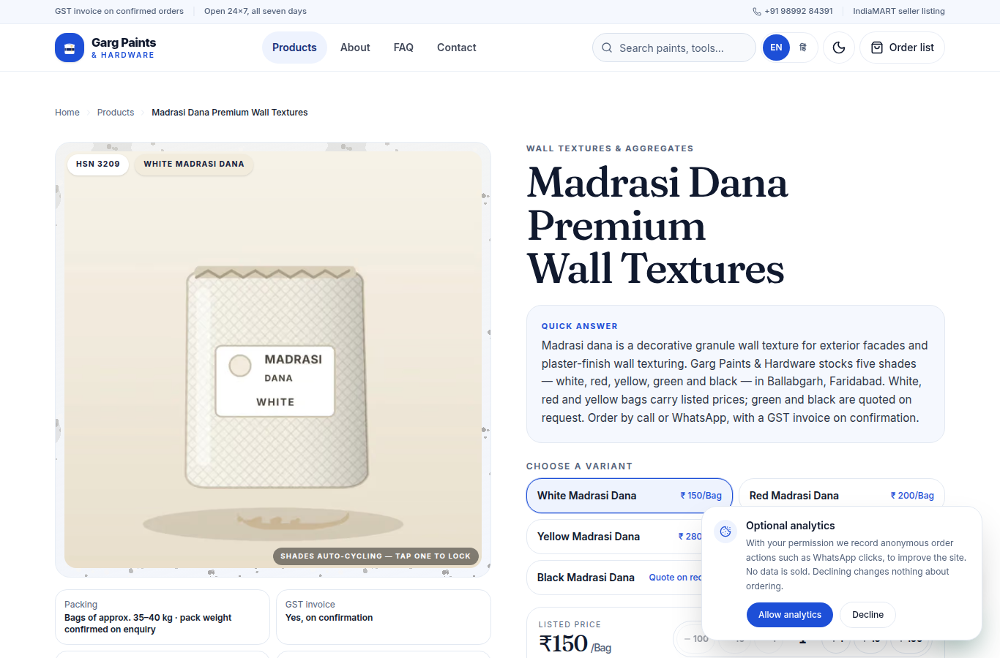
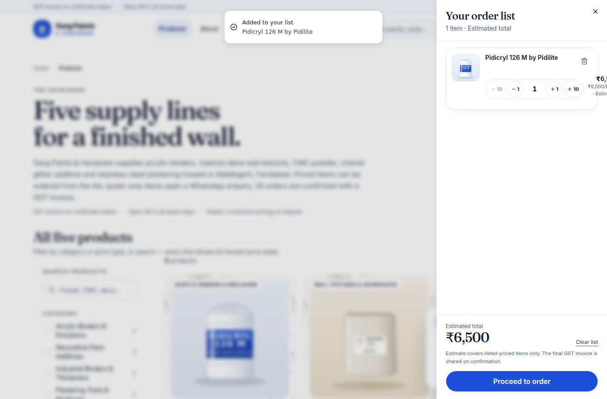
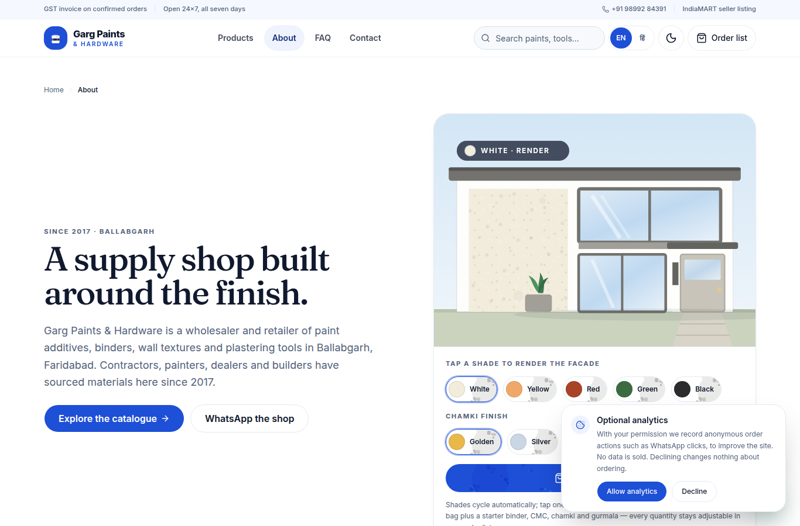
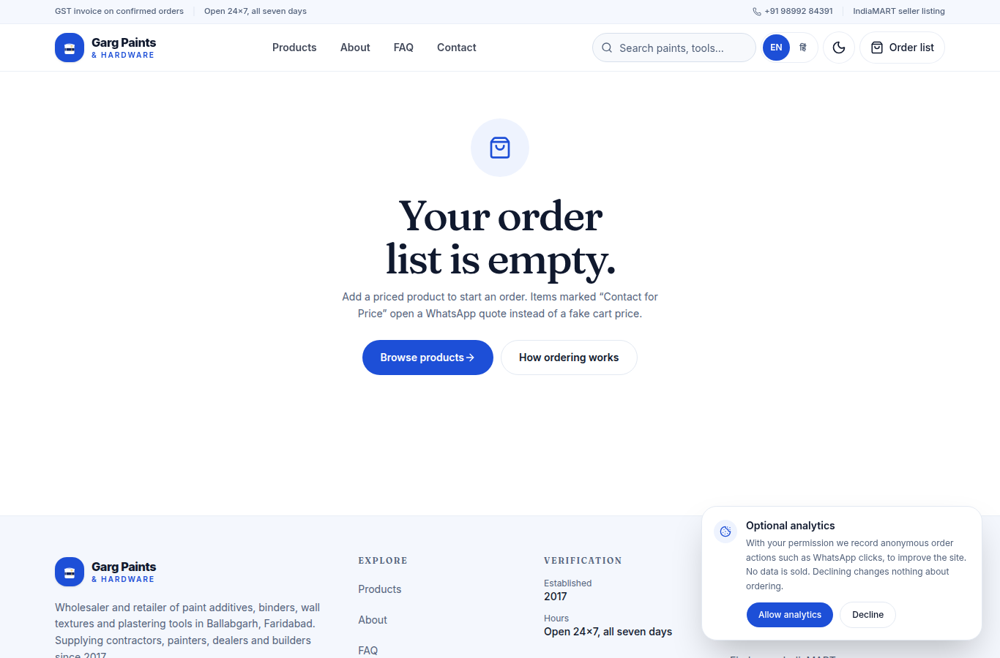
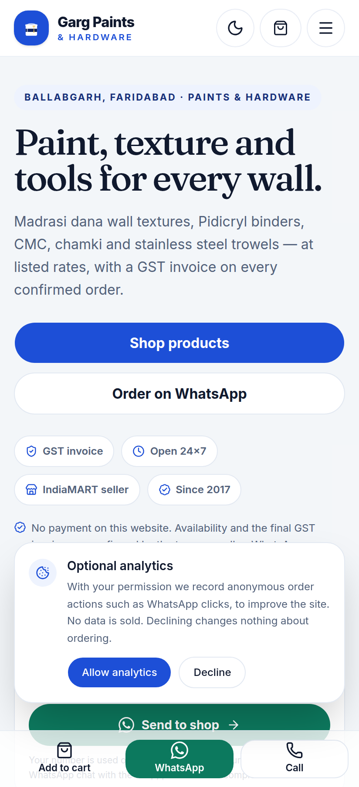

# Garg Paints & Hardware — Store Website

An order-first storefront for **Garg Paints & Hardware**, a wholesaler and
retailer of paint additives, binders, wall textures and plastering tools in
Ballabgarh, Faridabad (Haryana, India).

No payment gateway: the site builds an order list and hands the buyer to
**WhatsApp** (pre-filled order message with item, variant, quantity and
units) or **IndiaMART**, with a final GST invoice confirmed by the shop.
Lead capture collects a mobile number (no OTP) and pushes it to the shop.

**Live:** https://garg-paints-hardware.vercel.app
**Repo:** https://github.com/AmnGrg0511/garg-paints-hardware

## Screenshots

| | |
|---|---|
|  |  |
| **Home — colour visualizer + starter kit** | **Catalog with filters and search** |
|  |  |
| **Product detail — variant selector, bulk steppers** | **Order list with per-line bulk steppers** |
|  |  |
| **About — facade demo + chamki finish** | **Checkout — two order channels** |
|  | |
| **Mobile-first ordering bar** | |

## Stack

- **Next.js 16** (App Router, static prerendering), **TypeScript** strict
- **Tailwind CSS v4**, shadcn/base-ui, lucide icons
- Zustand cart (persisted, versioned with migrations)
- Interactive demos: interior colour visualizer (home) and facade visualizer
  (About) with madrasi dana shades, a chamki glitter finish
  (Golden/Silver/Off) and shade auto-cycling (all reduced-motion aware)
- **Order this setup**: one tap builds a starter kit for the picked shade —
  dana bag, pidicryl drum, CMC kg, chamki and a gurmala — fully adjustable in
  the order list
- Bulk-aware quantity steppers: bags ±1/±10/±100 (≈35–40 kg per bag), CMC and
  chamki in kg ±1/±5/±25 (5/25 kg bags, odd weights fine), pidicryl in drums
- Lead capture without OTP; forwards to an optional webhook
- SEO: JSON-LD (HardwareStore/WebSite/Product/ProductGroup/FAQPage/
  BreadcrumbList), sitemap, robots (incl. AI crawlers), llms.txt, OG images
- Art: hand-authored SVGs rasterized to WebP (`scripts/generate-art.mts`)

## Getting started

```bash
npm install
npm run dev        # http://localhost:3000
```

## Scripts

```bash
npm run build      # production build (all pages static)
npm run lint       # eslint
npm run verify     # order-path checks: exact WhatsApp message template,
                   # wa.me encoding, pricing, JSON-LD offer rules, GST rules
```

Browser end-to-end checks live in `scripts/` (require a local Chrome binary;
see `scripts/check-*.mjs`).

## Deployment

Deploys as a standard Next.js app (Node runtime) — Vercel/Netlify/
Cloudflare Pages(OpenNext)/self-hosted `next start` all work.

**Live on Vercel:** https://garg-paints-hardware.vercel.app
(Pushes to `main` redeploy automatically.)

### Environment variables

- `NEXT_PUBLIC_SITE_URL` — set to the final production domain (canonical,
  OG, sitemap and llms.txt all read it). Already set on Vercel.

#### Getting found on Google (the important part)

The site already ships everything Google needs to index it: unique titles
and descriptions per product, HardwareStore + Product/ProductGroup +
FAQPage structured data, breadcrumbs, a sitemap, llms.txt and an
AI-crawler-friendly robots.txt. What is missing is Google learning the site
exists — that is an owner step, not a code step:

1. **Verify the site in Google Search Console** (search.google.com/search-console).
   Easiest: choose the "HTML tag" method, copy the
   `google-site-verification=…` token, set it as
   `NEXT_PUBLIC_GSC_VERIFICATION` on Vercel and redeploy — the tag renders
   automatically.
2. **Submit the sitemap**: Search Console → Sitemaps → enter `sitemap.xml`.
3. **Request indexing** for the five product URLs (Search Console → URL
   Inspection → paste each URL → Request indexing). This is the fastest way
   to get product names searchable — new domains otherwise take days to
   weeks to be crawled.
4. **Create a Google Business Profile** with the shop's phone number (and
   the street address once confirmed) — this is what wins local "near me"
   searches in Faridabad.

Note: search rankings take time after indexing; the plumbing above is the
complete on-site portion.

#### Hindi (Devanagari)

The language toggle switches every UI string between English and proper
हिन्दी (Devanagari) — rendered with the Noto Sans Devanagari font that
loads on demand. Brand/product names (Pidicryl, Madrasi Dana, CMC, Chamki)
stay in Latin script inside the Hindi copy, as they appear on the labels.

#### Messaging rules (owner-approved)

The site sells the deal, not paperwork: no GST/invoice talk in customer
copy — the value props are better rates than anywhere, genuine quality
guarantee, quick delivery, and rates negotiated per order. Listed rates
are always presented as starting points; the final rate depends on
quantity and the customer's relationship with the shop.

#### Capturing numbers without WhatsApp

The one-field form sends itself the moment a complete 10-digit number
is typed — no extra tap (edits within a short pause cancel it; closing
the form flushes a pending number). The number is captured server-side
with no WhatsApp step required (desktop visitors without WhatsApp are
covered). WhatsApp stays one tap away as an optional channel that opens
a plain "Hello Mahesh" greeting; anyone who chats there is reachable
at that chat's number anyway.

`/api/lead` writes each lead to every channel configured:
   - **Vercel Blob** (recommended on Vercel): create a Blob store
     (Vercel → Storage → Blob) and connect it to the project — the
     `BLOB_READ_WRITE_TOKEN` env var is injected automatically. Each lead
     is stored as a **private** object, so it is only browsable from the
     dashboard with your own project access.
   - **File log** (self-hosted): `data/leads.jsonl` (git-ignored).
   - **Webhook push**: set `LEAD_WEBHOOK_URL` to have every lead pushed to
     you instantly:
     - The URL must be `https://` and may include an auth token if
       `LEAD_WEBHOOK_TOKEN` is set (sent as a Bearer header).
     - **Telegram**: create a bot with @BotFather, then point the webhook
       at `https://api.telegram.org/bot<TOKEN>/sendMessage?chat_id=<CHAT_ID>`
       — the number arrives on your phone the moment it is submitted.
     - **Google Sheets**: deploy an Apps Script web app that appends POST
       bodies to a sheet and set its URL here.

#### Updating rates from the Telegram bot

The shop's bot (@GargPaintsBot) is also the rate-control panel. Only
chats listed in `ADMIN_CHAT_IDS` can issue commands; everyone else gets
a polite redirect to the shop's WhatsApp (and their message is relayed
to the owner as a possible lead).

```
/rates                     — current rates shown on the site
/price trowel 80           — single-rate product
/price madrasi white 165   — one shade of a variant product
/price gph-02 red 1,250    — by id; commas and ₹ are fine
/quote cmc yellow          — back to "Contact for Bulk Quote"
/quote madrasi green       — back to "Contact for Price"
/reset                     — clear every override
```

**Batching:** send several commands in one message (one per line) and
they land as a single commit and a single deploy:

```
/price madrasi white 165
/price madrasi red 210
/price pidicryl 6800
```

Paste-friendly lines work too — `madrasi white - 165` without the
slash is read as a price update. Validation is all-or-nothing: if any
line is wrong, nothing is committed and the bot lists what to fix.
Lines apply in order, so `/reset` followed by price lines works as
written.

A change is committed to `catalog.overrides.json` in the repo through
the GitHub API, so every update is version-controlled and Vercel's git
integration deploys it automatically — live in about a minute.

Required environment variables: `TELEGRAM_BOT_TOKEN` (from @BotFather),
`TELEGRAM_WEBHOOK_SECRET` (random string, passed to setWebhook so
Telegram signs each call), `ADMIN_CHAT_IDS` (comma-separated chat ids),
`GITHUB_REPO` (`owner/name`) and `GITHUB_TOKEN` — a fine-grained PAT
with **Contents: read + write** on this repository only. Register the
webhook after deploying:

```
curl "https://api.telegram.org/bot<TOKEN>/setWebhook?url=https://<domain>/api/telegram&secret_token=<SECRET>"
```

Note: FAQ answers that mention a figure in prose (e.g. ₹130/Kg) are
owner-approved copy and change via the repo, not the bot. The bot
updates every rendered price surface: cards, detail pages, JSON-LD
offers, bulk chips, the starter kit and the cart.

## Data rules (do not break)

- The GST number is intentionally absent from the entire site.
- HSN codes are shown as owner-provided and require CA verification before
  invoicing.
- No delivery times, certifications, ratings or prices may be invented —
  anything not provided by the owner renders as "Contact for Price".
  Owner-provided marketing claims (better rates than anywhere, genuine
  quality guarantee, quick delivery, rates negotiable by quantity and
  relationship) are stated by the owner and kept as given.
- Listed rates are always framed as starting points, never final prices —
  the final rate is negotiated per order.
- The WhatsApp message template and per-unit quantities are owner-approved;
  `npm run verify` enforces them.
- Starter-kit quantities (`starterKit` in `src/config/businessData.ts`) are
  placeholders pending the owner's standard usage rates.
